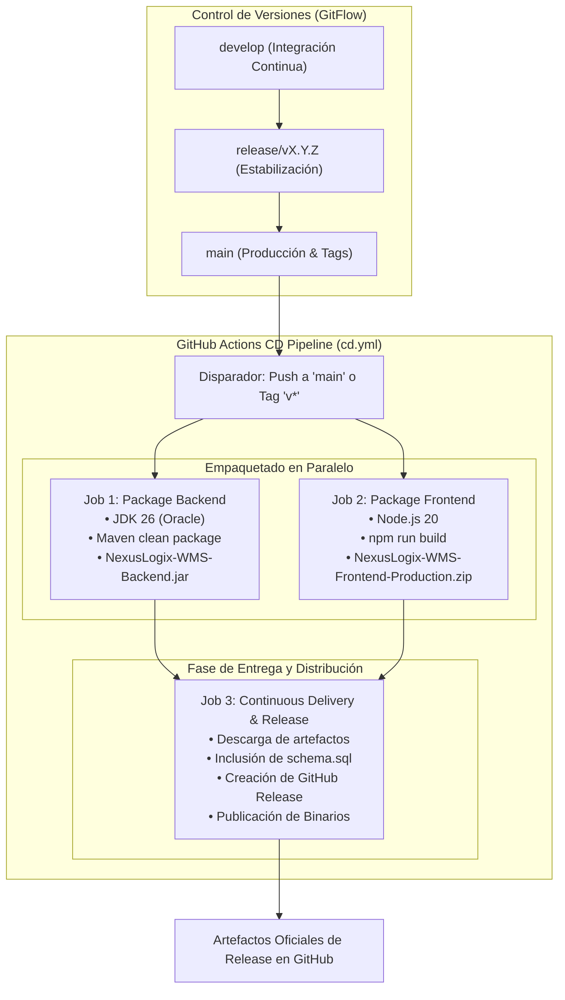

# Arquitectura de Entrega Continua (CD) - NexusLogix WMS

## 1. Visión General del Pipeline de CD
El pipeline de **Entrega Continua (Continuous Delivery - CD)** de **NexusLogix WMS** automatiza la generación de entregables de producción tras la validación satisfactoria de la Integración Continua (CI). Permite empaquetar, versionar y publicar de forma desatendida los artefactos binarios ejecutables tanto del Backend (Spring Boot) como del Frontend (React + Vite), adjuntando el esquema DDL de la base de datos relacional MySQL.

---

## 2. Diagrama de Arquitectura GitFlow & CD



---

## 3. Especificación Técnica de los Jobs

### Fase 1: `package-backend`
* **Entorno:** `ubuntu-latest` con JDK 26 (Oracle).
* **Comando:** `./mvnw clean package -DskipTests -B`
* **Salida:** `target/nexuslogix-1.0.0.jar` renombrado a `NexusLogix-WMS-Backend.jar`.
* **Almacenamiento Temporal:** Subido como artefacto de workflow con retención de 7 días.

### Fase 2: `package-frontend`
* **Entorno:** `ubuntu-latest` con Node.js 20 LTS.
* **Comandos:**
  ```bash
  npm ci
  npm run build
  zip -r NexusLogix-WMS-Frontend-Production.zip .
  ```
* **Salida:** Archivo ZIP optimizado con los assets estáticos de producción (HTML, JS, CSS).

### Fase 3: `publish-delivery`
* **Dependencias:** Requiere la finalización exitosa de `package-backend` y `package-frontend`.
* **Permisos Requeridos:** `contents: write`, `packages: write` mediante `GITHUB_TOKEN`.
* **Acción Automatizada:** Utiliza `softprops/action-gh-release@v2` para:
  1. Detectar o calcular dinámicamente el tag de la versión (`v1.0.0`, `v2.0.0`, etc.).
  2. Generar notas de versión automáticas (*Release Notes*).
  3. Adjuntar como archivos de descarga:
     - `NexusLogix-WMS-Backend.jar`
     - `NexusLogix-WMS-Frontend-Production.zip`
     - `NexusLogix-Database-Schema.sql`

---

## 4. Métodos de Disparo (Triggers)

1. **Automático por Merge a `main`:** Cada vez que se aprueba un Pull Request desde una rama `release/*` o `hotfix/*` hacia `main`.
2. **Automático por Git Tag:** Al crear y empujar una etiqueta de versión:
   ```bash
   git tag -a v2.0.0 -m "Release v2.0.0 Enterprise"
   git push origin v2.0.0
   ```
3. **Manual (`workflow_dispatch`):** Desde la pestaña **Actions** de GitHub, seleccionando el flujo **NexusLogix CD** e ingresando la versión deseada.

---

## 5. Matriz de Cumplimiento de la Rúbrica

| Requisito de la Rúbrica | Implementación en NexusLogix WMS | Estado |
| :--- | :--- | :---: |
| **Pipeline CD automatizado** | Workflow `.github/workflows/cd.yml` activado por eventos Git y manuales. |  Cumplido |
| **Completo (Fullstack + BD)** | Empaqueta JAR ejecutable, bundle frontend ZIP y script DDL de base de datos. |  Cumplido |
| **Generación de Entregables** | Publicación desatendida de GitHub Releases con binarios descargables. |  Cumplido |
| **Documentación Técnica** | Manual completo en `docs/CONTINUOUS_DELIVERY.md` y referencia en `README.md`. |  Cumplido |
